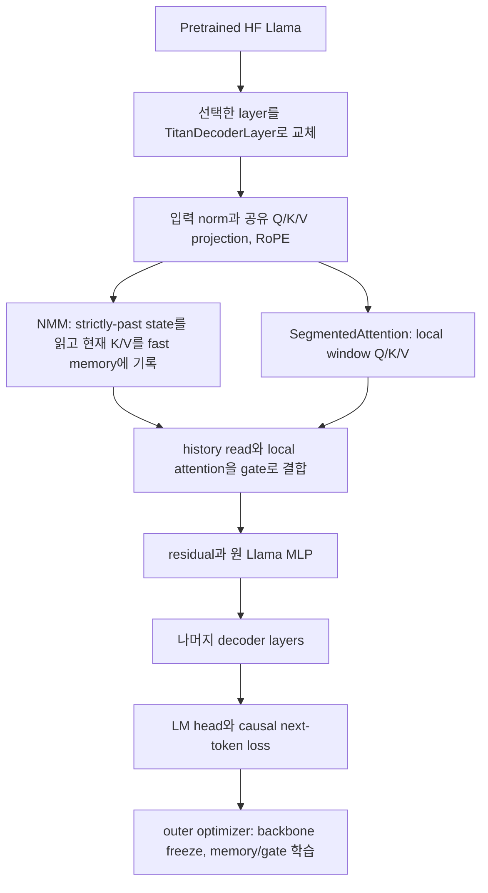
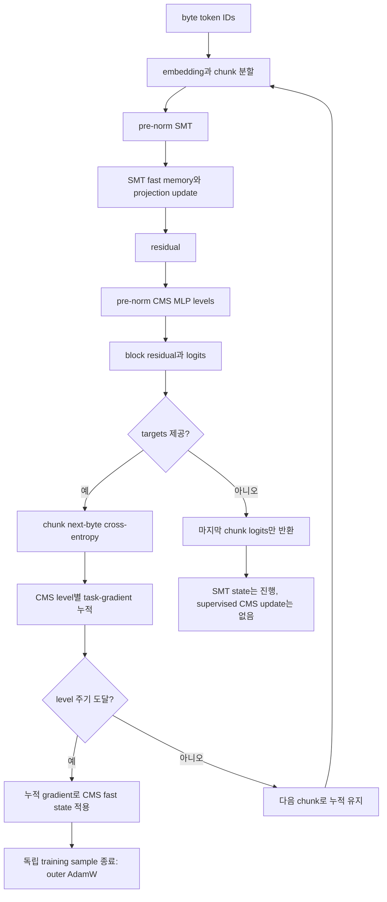

# 실행 흐름과 상태 경계

이 문서는 저장소에 있는 두 실행 경로를 따라갑니다. Titan-Llama는 사전학습 Llama의 일부 attention layer를 NMM으로 바꾸는 retrofit이고, HOPE는 자체 byte-level 모델에서 SMT와 CMS를 연결합니다. 이들은 하나의 결합 모델이 아닙니다.

## Titan-Llama: pretrained layer에서 다음 token loss까지

[titan_llama.py](https://github.com/jimmylegendary/titans-hope-lab/blob/main/implementations/titan-llama/titan_llama.py#L1192-L1222)는 Hugging Face backbone을 읽고 설정된 layer만 `TitanDecoderLayer`로 교체합니다. 대체 layer는 원 Llama의 norm과 MLP를 재사용하고 Q/K/V/O projection을 복사한 뒤 segmented attention과 Neural Memory Module을 붙입니다. 다음 링크는 구현의 주요 경계입니다: [neural_memory.py](https://github.com/jimmylegendary/titans-hope-lab/blob/main/implementations/titan-llama/titans_pytorch/neural_memory.py#L1488-L1578), [mac_transformer.py](https://github.com/jimmylegendary/titans-hope-lab/blob/main/implementations/titan-llama/titans_pytorch/mac_transformer.py#L480-L493), [train_titan_llama.py](https://github.com/jimmylegendary/titans-hope-lab/blob/main/implementations/titan-llama/train_titan_llama.py#L168-L316).

`TitanDecoderLayer.forward_core`는 입력을 정규화한 뒤 query/key/value를 만들고 rotary embedding을 적용합니다. NMM은 `token_shift`가 적용된 key/value 경로로 현재 시점보다 앞선 memory를 읽으며, 현재 chunk를 state에 반영해 다음 호출용 state를 반환합니다. 읽어온 memory vector는 local segmented attention 결과와 함께 gate를 거쳐 residual stream으로 들어갑니다. MLP는 원 backbone layer의 것을 씁니다. 따라서 메모리 read가 현재 token의 K/V를 미리 보게 하지 않는 순서를 코드가 구성합니다.

학습은 causal language-model loss를 사용합니다. 모델 설정은 선택 layer를 한정하고 pretrained backbone을 freeze하며 추가 memory 경로를 최적화합니다. 기준 accuracy 구성에서 논문은 16개 중 첫 4개 layer만 바꾸고 나머지 12개 full-attention layer를 유지합니다. 이 실행 경로는 모든 attention layer를 대체하는 구성을 뜻하지 않습니다.

생성에서는 기본적으로 memory state를 초기화하고 prompt를 처리한 뒤 cache를 이어 씁니다. 변환 layer는 local window에 맞는 cache와 `TitanLayerState`를 유지하고, 미변환 layer는 HF cache를 사용합니다. 구현 세부는 [titan_llama.py](https://github.com/jimmylegendary/titans-hope-lab/blob/main/implementations/titan-llama/titan_llama.py#L1035-L1136), freeze 경로는 [titan_llama.py](https://github.com/jimmylegendary/titans-hope-lab/blob/main/implementations/titan-llama/titan_llama.py#L1140-L1178)에 있습니다.

## HOPE: chunk, SMT, CMS, 그리고 두 update clock

[model.py](https://github.com/jimmylegendary/titans-hope-lab/blob/main/implementations/hope/hope/model.py#L577-L740)는 chunk마다 HOPE block을 호출합니다. 각 block은 norm → self-modifying Titans (SMT) → residual → norm → Continuum Memory System (CMS) → residual 순서입니다. SMT에는 문맥에 맞춰 변하는 fast memory/update 경로가 있고, CMS는 서로 다른 주기를 가진 느린 MLP memory level을 가집니다.

대상 `targets`가 있으면 각 chunk의 다음 byte 예측 loss를 만들고, CMS memory parameter에 대한 gradient를 state에 쌓습니다. 각 level은 자기 period clock에 따라 누적분을 적용합니다. 현재 코드의 경계식은 `(chunk_idx + 2) % period == 0`이며, upstream의 기준 수식과 다른 phase로 [DEVIATIONS.md](https://github.com/jimmylegendary/titans-hope-lab/blob/main/implementations/hope/docs/DEVIATIONS.md)에 기록돼 있습니다. 완료한 독립 sample의 학습 가능한 초기값과 일반 parameter는 바깥 AdamW step이 갱신합니다.

기본 matrix 경로는 main memory의 chunk-parallel recurrence를 사용합니다. 선택적 deep 경로는 chunk 시작 memory를 읽으므로 업데이트가 다음 chunk에 반영되는 한-chunk lag가 있습니다. projection memory의 scalar-decay 근사, 고정 query 등 나머지 차이는 stability/deviation 문서에 기록돼 있습니다. [model.py](https://github.com/jimmylegendary/titans-hope-lab/blob/main/implementations/hope/hope/model.py#L140-L559)와 [STABILITY.md](https://github.com/jimmylegendary/titans-hope-lab/blob/main/implementations/hope/docs/STABILITY.md)를 참고하세요.

`targets=None` 추론 API는 마지막 chunk의 logits만 돌려주며 SMT state는 처리되지만 CMS에는 supervised task-gradient update가 없습니다. CLI의 byte generation은 다른 경로입니다. 이미 관측한 prefix의 다음-byte labels를 만들고 마지막 위치만 `-1`로 마스킹해 새 state에서 prefix를 replay한 뒤 다음 byte를 샘플링합니다. 샘플된 미래 byte를 label로 먼저 읽지 않습니다. prefix 길이가 chunk 경계에 맞지 않으면 끝의 partial chunk를 해당 replay에서 마무리하고, 다음 단계에서는 prefix 전체를 다시 계산합니다. 구현은 [cli.py](https://github.com/jimmylegendary/titans-hope-lab/blob/main/implementations/hope/hope/cli.py#L120-L290)에 있습니다.

Checkpoint는 optimizer step과 stream 경계에서 model/optimizer/RNG와 실행 조건을 저장합니다. runtime recurrent state나 autograd graph를 이어 저장하지 않으므로 resume은 같은 corpus와 config를 사용해 새 stream 경계에서 시작합니다. 직렬화 범위는 [checkpoint.py](https://github.com/jimmylegendary/titans-hope-lab/blob/main/implementations/hope/hope/checkpoint.py)에 설명돼 있습니다. all-ignored tail의 주 loss와 activation-checkpoint side loss는 valid-token count로 나누며, 유효 token이 없을 때 finite zero가 되도록 처리합니다.
